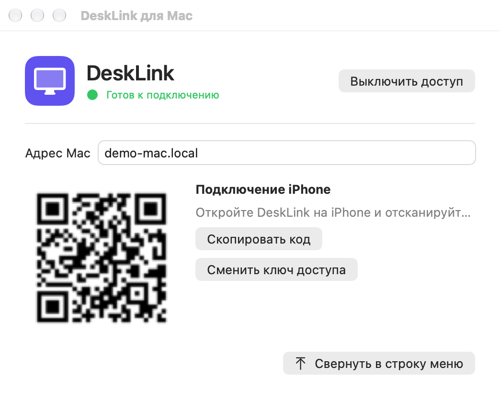
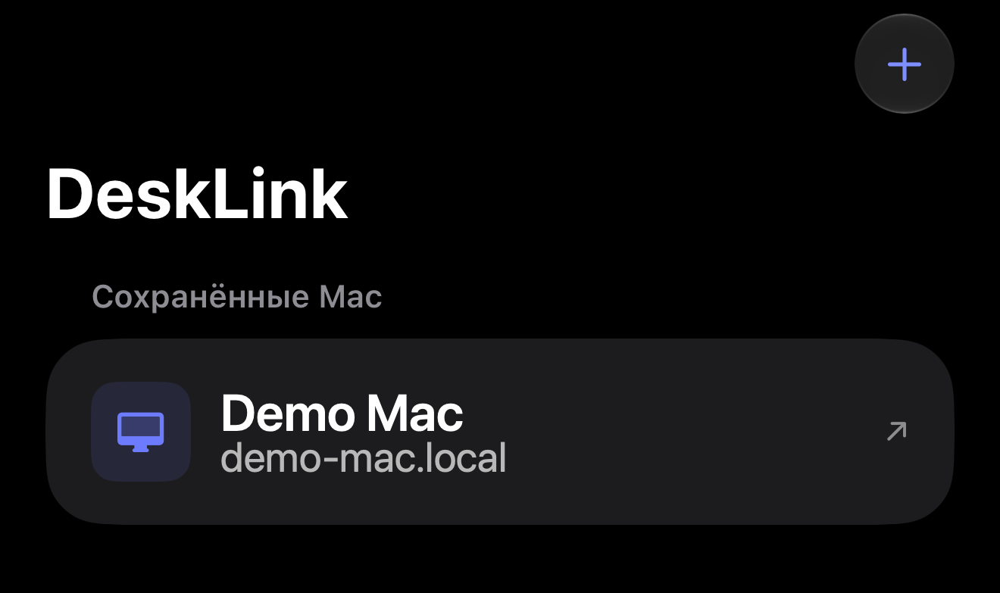

# DeskLink

[Русский](README.md)

DeskLink lets you control your Mac's current desktop session from an iPhone or iPad. It supports direct touch, trackpad mode, an on-screen keyboard with shortcuts, Mac audio, a shared text clipboard, and switching between displays.

## Screenshots

| DeskLink Host on macOS | Saved connection on iPhone |
| --- | --- |
|  |  |

The screenshots show an example Mac name, address, and QR code. Use the QR code from your own DeskLink Host to pair.

## Install from source

You need a Mac running macOS 15 or later, an iPhone or iPad running iOS/iPadOS 18 or later, and a version of Xcode that supports your device's OS. The build was verified with Xcode 27.2. [Download Xcode](https://developer.apple.com/xcode/), [compatibility table](https://developer.apple.com/xcode/system-requirements/).

1. On GitHub, choose **Code → Download ZIP**, extract the archive, and open `DeskLink.xcodeproj` in Xcode. You can also clone the repository.

   ```sh
   git clone https://github.com/Sampsih/DeskLink.git
   cd DeskLink
   open DeskLink.xcodeproj
   ```

2. **On the Mac.** Select the **DeskLink Host** scheme and **My Mac**, then press **⌘R**. In DeskLink Host, use the “Разрешить” (Allow) buttons to open System Settings. Grant Screen & System Audio Recording and Accessibility permissions. Restart DeskLink Host if macOS prompts you to.
3. **On the iPhone or iPad.** Connect the device to your Mac over USB, unlock it, and tap Trust if prompted. In **Xcode → Settings → Apple Accounts**, add your Apple Account.
4. In the Xcode project navigator, open the project and select the **DeskLink → Signing & Capabilities** target settings. Turn on **Automatically manage signing**, choose your **Team**, and enter a unique **Bundle Identifier**, such as `com.yourname.desklink`.
5. Select the **DeskLink** scheme and the connected device, then press **⌘R**. If Xcode asks for Developer Mode, go to **Settings → Privacy & Security → Developer Mode** on the device, restart and confirm that you want to enable it, and then press **⌘R** again in Xcode. [Running on a physical device](https://developer.apple.com/documentation/xcode/running-your-app-on-simulated-or-physical-devices), [enabling Developer Mode](https://developer.apple.com/documentation/xcode/enabling-developer-mode-on-a-device).

For personal use, you can sign with a free **Personal Team**. Its provisioning profile expires after seven days. Run the build on your device again with the same app identifier to renew it. [Personal Team limits](https://developer.apple.com/help/account/basics/about-your-developer-account/).

## First connection over Wi-Fi

1. Open DeskLink Host on your Mac and click “Включить доступ” (Enable access). Keep the Mac awake and signed in.
2. Connect the iPhone or iPad to the same Wi-Fi network. In DeskLink, tap “Добавить Mac” (Add Mac) or the plus button in the top-right corner, allow camera access, and scan the QR code from the Mac.
3. Tap the saved Mac and allow local network access if prompted. If the `.local` hostname does not resolve, touch and hold the saved Mac, choose “Изменить адрес” (Edit address), and enter the Mac's local IP address.

Tap to click, scroll with two fingers, and tap with two fingers to right-click. Touch and hold, then move to drag. Pinch to zoom. Use the top bar to switch to trackpad mode or show the keyboard. The ellipsis menu contains audio, clipboard, and display controls.

## Connect over the internet

For personal remote access, use **Tailscale** to put both devices on the same private VPN. This usually works without router port forwarding. The devices connect directly when possible and use a relay when needed. [Tailscale device connectivity](https://tailscale.com/docs/reference/device-connectivity), [firewall and port guidance](https://tailscale.com/docs/reference/faq/firewall-ports).

1. Install Tailscale on your Mac and your iPhone or iPad. Sign in to the same Tailscale network on both devices and turn on the VPN. [Tailscale for macOS](https://tailscale.com/docs/install/mac), [Tailscale for iOS](https://tailscale.com/docs/install/ios).
2. Copy the Mac's Tailscale IP, which looks like `100.x.y.z`. For a new pairing, put it in “Адрес Mac” (Mac address) before scanning the QR code. For an existing pairing, touch and hold the saved Mac on the iPhone, choose “Изменить адрес” (Edit address), and enter the IP. [Find the device's Tailscale IP](https://tailscale.com/docs/how-to/connect-to-devices).
3. Leave DeskLink Host running with access enabled. To test from a different network, turn off Wi-Fi on your iPhone and connect over cellular. If another VPN is active on the iPhone, switch to Tailscale. [Using other VPNs with Tailscale](https://tailscale.com/docs/reference/faq/other-vpns).

If you already have a private VPN, use the Mac's address on that VPN. TCP port `49169` must be reachable between the two devices. Keep that port limited to your trusted local network and private VPN.

DeskLink encrypts the session with TLS 1.3. The client verifies the Mac's certificate fingerprint from the QR code. The QR code also contains the access key. Use “Сменить ключ доступа” (Rotate access key) to revoke existing pairings.

### Built-in internet access option

A future release could add a relay for users who want remote access without a separate VPN app. The Mac and iPhone would make outbound connections to the relay on port 443. The relay would forward encrypted DeskLink traffic, while Mac authentication and certificate verification would stay on the devices. This would require a server and add latency when video travels through it. The current version uses a local network or a private VPN.

## macOS menu bar

Click “Свернуть в строку меню” (Minimize to the menu bar) or close the DeskLink Host window. The host and any active session keep running. Use the monitor icon in the menu bar to reopen the window, enable or disable access, or quit DeskLink.
