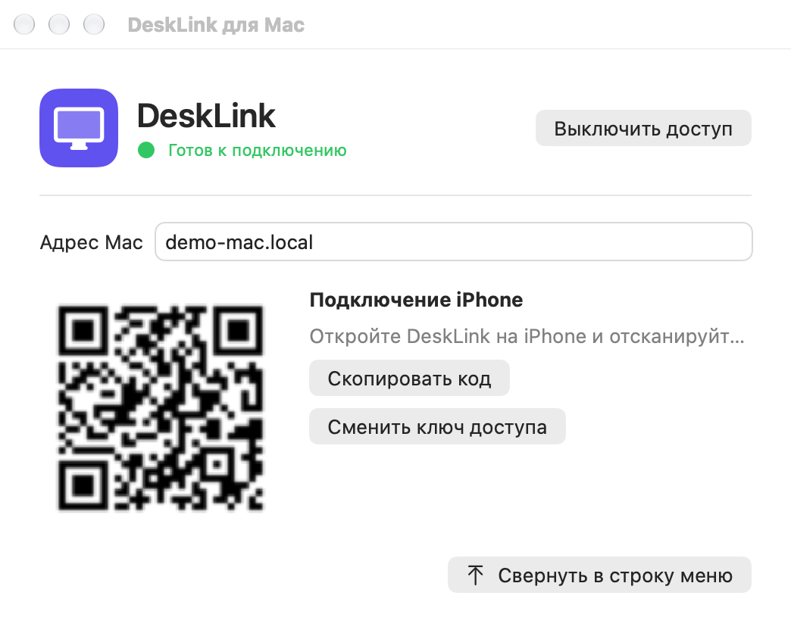
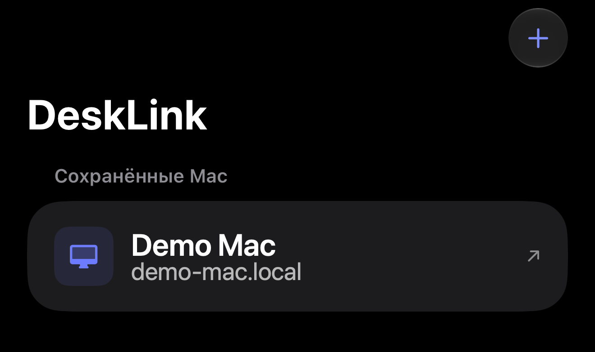

# DeskLink

[English](README.en.md)

DeskLink позволяет управлять текущим рабочим столом Mac с iPhone или iPad. В приложении есть прямое управление касаниями, режим трекпада, клавиатура с сочетаниями, звук Mac, текстовый буфер обмена и переключение между дисплеями.

## Скриншоты

| DeskLink Host на Mac | Сохранённое подключение на iPhone |
| --- | --- |
|  |  |

На скриншотах показаны демонстрационные имя Mac, адрес и QR-код. Для подключения используйте QR-код из своего DeskLink Host.

## Установка из исходников

Понадобятся Mac с macOS 15 или новее, iPhone или iPad с iOS/iPadOS 18 или новее и Xcode, который поддерживает версию ОС на вашем устройстве. Сборка проверена в Xcode 27.2. [Скачать Xcode](https://developer.apple.com/xcode/), [таблица совместимости](https://developer.apple.com/xcode/system-requirements/).

1. На GitHub выберите **Code → Download ZIP**, распакуйте архив и откройте `DeskLink.xcodeproj` в Xcode. Или скачайте проект через Git.

   ```sh
   git clone https://github.com/Sampsih/DeskLink.git
   cd DeskLink
   open DeskLink.xcodeproj
   ```

2. **На Mac.** Выберите схему **DeskLink Host**, устройство **My Mac** и нажмите **⌘R**. В DeskLink Host нажмите «Разрешить» рядом с записью экрана и звука и рядом с управлением мышью и клавиатурой. Включите оба разрешения в системных настройках. Если macOS попросит, перезапустите DeskLink Host.
3. **На iPhone или iPad.** Подключите устройство к Mac по USB, разблокируйте его и подтвердите «Доверять» при запросе. В **Xcode → Settings → Apple Accounts** добавьте свой Apple Account.
4. В навигаторе Xcode откройте проект, затем цель **DeskLink → Signing & Capabilities**. Включите **Automatically manage signing**, выберите свою команду в поле **Team** и задайте уникальный **Bundle Identifier**, например `com.vash-login.desklink`.
5. Выберите схему **DeskLink**, укажите подключённое устройство и нажмите **⌘R**. Если Xcode попросит включить «Режим разработчика», откройте **Настройки → Конфиденциальность и безопасность → Режим разработчика** на устройстве, перезапустите его, подтвердите включение и снова нажмите **⌘R** в Xcode. [Установка на физическое устройство](https://developer.apple.com/documentation/xcode/running-your-app-on-simulated-or-physical-devices), [режим разработчика](https://developer.apple.com/documentation/xcode/enabling-developer-mode-on-a-device).

Для установки на своё устройство подходит бесплатная команда **Personal Team**. Её профиль действует 7 дней. После истечения запустите сборку на устройстве снова с тем же идентификатором приложения. [Ограничения Personal Team](https://developer.apple.com/help/account/basics/about-your-developer-account/).

## Первое подключение по Wi-Fi

1. Запустите DeskLink Host на Mac и нажмите «Включить доступ». Оставьте Mac включённым, а сеанс macOS открытым.
2. Подключите iPhone или iPad к той же сети Wi-Fi. В DeskLink нажмите «Добавить Mac» или «+» в правом верхнем углу, разрешите доступ к камере и отсканируйте QR-код с Mac.
3. Нажмите на сохранённый Mac и разрешите доступ к локальной сети при запросе. Если локальное имя `.local` не разрешается, удерживайте карточку Mac в списке, выберите «Изменить адрес» и введите локальный IP-адрес Mac.

Одно касание выполняет щелчок, два пальца прокручивают содержимое, касание двумя пальцами открывает контекстное меню. Удерживайте и перемещайте палец, чтобы перетащить объект. Сведите или разведите пальцы, чтобы изменить масштаб. На верхней панели доступны трекпад и клавиатура, а под кнопкой «…» находятся настройки звука, текстового буфера обмена и дисплея.

## Подключение через интернет

Для доступа к своему Mac из другой сети подойдёт **Tailscale**. Он даёт обоим устройствам адреса в общей частной VPN. Обычно проброс портов на роутере не нужен. Устройства соединяются напрямую, когда сеть это позволяет, либо через ретранслятор. [Как соединяются устройства Tailscale](https://tailscale.com/docs/reference/device-connectivity), [порты и NAT](https://tailscale.com/docs/reference/faq/firewall-ports).

1. Установите Tailscale на Mac и iPhone или iPad. Войдите на обоих устройствах в одну сеть Tailscale и включите VPN. [Tailscale для macOS](https://tailscale.com/docs/install/mac), [Tailscale для iOS](https://tailscale.com/docs/install/ios).
2. Скопируйте Tailscale IP вашего Mac вида `100.x.y.z`. Для первого подключения укажите его в поле «Адрес Mac» перед сканированием QR-кода. Если Mac уже добавлен, удерживайте его карточку на iPhone, выберите «Изменить адрес» и введите тот же IP. [Где найти адрес Tailscale](https://tailscale.com/docs/how-to/connect-to-devices).
3. Оставьте DeskLink Host запущенным с включённым доступом. Проверьте соединение с мобильного интернета, выключив Wi-Fi на iPhone. Если на iPhone включена другая VPN, переключитесь на Tailscale. [Совместимость с другими VPN](https://tailscale.com/docs/reference/faq/other-vpns).

Если у вас уже есть личная VPN, укажите в DeskLink адрес Mac в этой сети. Между устройствами должен быть доступен TCP-порт `49169`. Оставьте этот порт доступным только в доверенной локальной сети и личной VPN.

DeskLink шифрует сеанс с помощью TLS 1.3. Клиент проверяет отпечаток сертификата Mac из QR-кода. Этот код содержит ключ доступа. Кнопка «Сменить ключ доступа» отзывает ранее добавленные подключения.

### Вариант встроенного доступа

Для доступа без отдельного VPN-приложения можно добавить ретранслятор. Mac и iPhone будут открывать исходящие соединения к нему по порту 443, а он будет передавать зашифрованный поток DeskLink между устройствами. Аутентификацию Mac и проверку сертификата можно оставить на устройствах. Такой режим потребует сервера и добавит задержку, когда видео идёт через него. Текущая версия использует локальную сеть или личную VPN.

## Строка меню macOS

Нажмите «Свернуть в строку меню» или закройте окно DeskLink Host. Хост продолжит работать, включая текущий сеанс. Через значок монитора в строке меню можно снова показать окно, включить или выключить доступ и завершить DeskLink.
